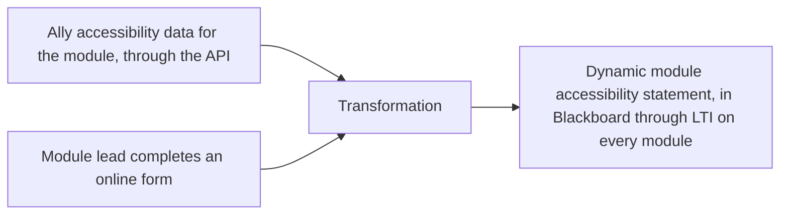
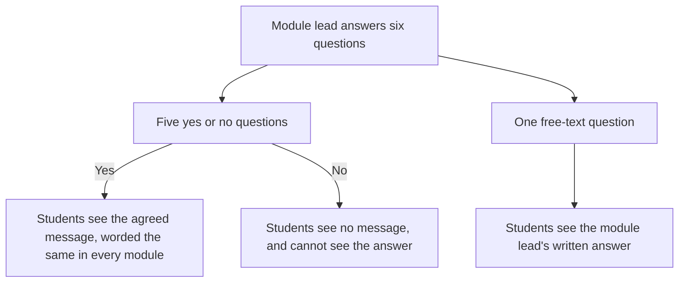
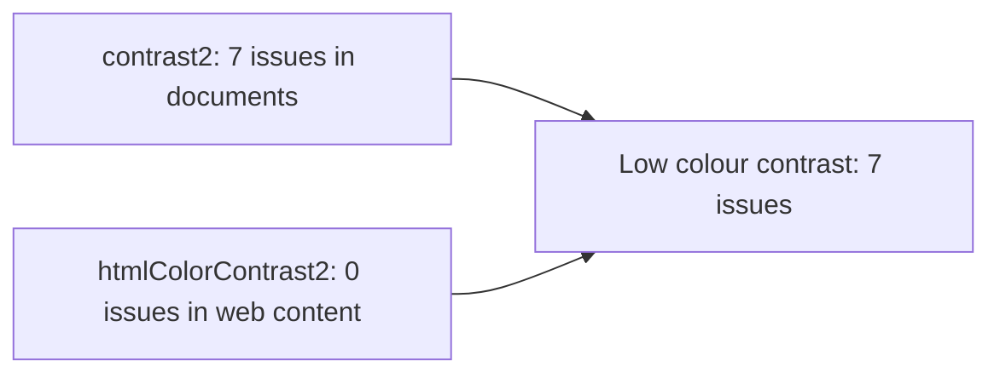
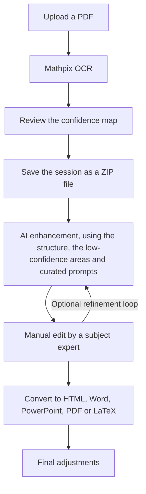
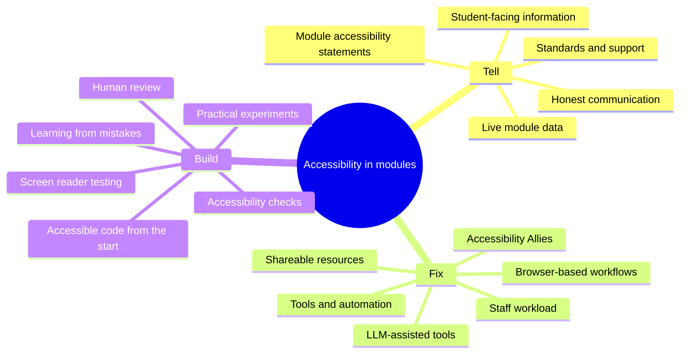

Speaker
: Matthew Deeprose, Accessible Solutions Architect, University of Southampton

Event
: AbilityNet TechShare Pro 2026, AI and Accessibility stream, 18 November 2026

Recording
: My own recording of the talk, made after the event, 27 minutes

## About this transcript

This is a transcript of my talk [Your module has 47 accessibility issues. Now what?](ts26.html) The talk page has the slides and every link I mention.

I've edited the captions lightly so they read well as text. I've removed repeated words, added headings, and where I read text from the screen I've used the wording on the screen. I've also added images from the slides, still frames from the demonstration videos, and diagrams and charts built from the slide content. Each diagram and chart has its own text description. Boxes headed "From the slide" hold details that were on screen but that I didn't say aloud.

## Watch the talk

<!-- Keep this block as it is: no blank lines inside it, no line indented by 4 spaces, no title attribute. -->
<div class="videoWrapper">
<lite-youtube videoid="TYaY9faoHq4" style="background-image: url('images/ts26-video-thumbnail.png');">
<a href="https://www.youtube.com/watch?v=TYaY9faoHq4" class="lty-playbtn">
<span class="lyt-visually-hidden">Play video: Your module has 47 accessibility issues. Now what?</span>
</a>
</lite-youtube>
</div>

Each part of the transcript below has a link to the same point in the video.

## Transcript options

The images repeat what the transcript already says, so you may prefer to hide them, to save data or to read the text on its own. The diagrams and charts stay visible, because they carry their own descriptions.

<fieldset class="transcript-options">
<legend>Slide images and video stills</legend>
<input type="radio" id="transcript-figures-show" name="transcript-figures" value="show" checked>
<label for="transcript-figures-show">Show images</label>
<input type="radio" id="transcript-figures-hide" name="transcript-figures" value="hide">
<label for="transcript-figures-hide">Hide images</label>
</fieldset>

[toc]

## Why I recorded this version

[Watch this part on YouTube, from the start](https://www.youtube.com/watch?v=TYaY9faoHq4&t=0s)

**Matthew Deeprose:** I was at AbilityNet's TechShare Pro last week, a fantastic accessibility conference. But I noticed that the recording of my session missed the first 10 minutes and looked like we were in a very dark room. So I've recorded this version for those who wanted to watch it online, but missed the start or found it hard to see. I also added back a few slides that I had removed to save time on the day. So here it is.

<figure class="demoImage">

<figcaption>What it looked like in the room. Photo by Ronny Hendriks, shared on LinkedIn.</figcaption>
</figure>

<figure class="demoImage">

<figcaption>How the conference recording looked, three minutes later.</figcaption>
</figure>

## Introduction

[Watch this part on YouTube, from 0:27](https://www.youtube.com/watch?v=TYaY9faoHq4&t=27s)

Welcome to "Your module has 47 accessibility issues. Now what?" You'll find the slides and links I mention at [go.soton.ac.uk/ts26](https://go.soton.ac.uk/ts26), and this link is on most slides.

I'm Matthew Deeprose, Accessible Solutions Architect at the University of Southampton. I'm a white, middle-aged man in a blue suit and a pocket square. My pronouns are he/him.

### A classic university accessibility issue

This talk sits in a university context, but those of you in other industries and areas will spot parallels of interest.

On screen are two images. First, a line drawing of a piston in a cylinder, and second, a scanned maths solution sheet with typeset questions and handwritten answers. Without a description or an accessible digital version, a screen reader user might hear each one as just "graphic".

<figure class="demoImage">

<figcaption>The piston diagram. A screen reader might announce it only as "graphic".</figcaption>
</figure>

<figure class="demoImage">

<figcaption>A scanned solution sheet that mixes typeset questions and handwritten answers.</figcaption>
</figure>

Everyone can benefit from accessibility features. Here, the handwriting's hard to read, and we can't adjust the colours, fonts or line height.

### 47 accessibility issues

[Watch this part on YouTube, from 1:33](https://www.youtube.com/watch?v=TYaY9faoHq4&t=93s)

Universities share their teaching resources with students on a website called a VLE, or virtual learning environment, and almost two thirds of our modules have 47 or more accessibility issues. On screen I have an example of the volume of issues affecting one business module. It includes missing alternative text, insufficient contrast, missing headings, untagged PDFs and scanned content that isn't machine readable at all.

On the slide, each of the 47 issues is a coloured tile, grouped by type. This chart shows the same counts.

```chart
{
  "type": "bar",
  "data": {
    "labels": ["No alt text", "Low contrast", "No headings", "Tables with no headers", "No document title", "No language set", "Untagged PDF", "OCR to check", "Scanned PDF with no text"],
    "datasets": [{
      "label": "Number of issues",
      "data": [11, 11, 10, 7, 4, 1, 1, 1, 1]
    }]
  },
  "options": {
    "indexAxis": "y",
    "responsive": true,
    "plugins": {
      "title": {
        "display": true,
        "text": "The 47 accessibility issues in one business module, by type"
      },
      "legend": { "display": false }
    }
  }
}
```

::: info
**From the slide:** the module is one Southampton Business School module with 363 students and 58 content items, and an Ally score of 79 per cent in 2025 to 2026. A band across the foot of the slide reads: "Not three jobs of ten hours. A hundred jobs of 30 minutes." The median across our modules is 68 issues; 47 was the figure when I submitted the talk.
:::

Office's Accessibility Assistant and our staff and student training cover a lot. But some modules, particularly in STEM, that's science, technology, engineering and maths, have niche accessibility puzzles to solve.

### In this session

[Watch this part on YouTube, from 2:18](https://www.youtube.com/watch?v=TYaY9faoHq4&t=138s)

This session is in three parts, each drawn from recent and in-flight work at the University of Southampton.

1. **Tell:** how do we tell students which accessibility barriers they may meet in a module?
2. **Fix:** how do we help staff fix those barriers at a scale that matters?
3. **Build:** when we build the tools that help, how do we build them accessibly from the first line of code?

## Part 1: Tell

[Watch this part on YouTube, from 2:45](https://www.youtube.com/watch?v=TYaY9faoHq4&t=165s)

In terms of telling students, I'm going to introduce module accessibility statements. They matter because one in five of our students now disclose a disability. That's up from one in seven four years ago.

### What are module accessibility statements?

You've hopefully heard of accessibility statements for a whole platform. A module accessibility statement covers just the online resources that support a module or course. We think that they should:

- explain what the module lead has done to make their module accessible
- highlight existing accessibility features that may help students, raising awareness for everyone
- explain, in student-friendly, practical terms, what accessibility barriers they may face

In fact, one measure in AbilityNet's maturity model for education is whether institutions set this out for students.

### The common pitfalls

Conversations with other universities showed we're not the first to try this, and they shared the common pitfalls.

- Adoption was patchy: some staff wrote a statement and others did not, so students had an inconsistent experience.
- The statements read as dry and legalistic, listing problems without coping strategies or solutions.
- Most were Word documents built from a template, so they went out of date quickly.
- They could sit anywhere in a module, which again hurt consistency.
- That made them hard to monitor centrally.

### Our approach

[Watch this part on YouTube, from 4:16](https://www.youtube.com/watch?v=TYaY9faoHq4&t=256s)

Our approach starts with two inputs. Our VLE provides module accessibility data through an API, which is a way to extract and share data over the internet. And an online form asks module leads about their practice. We transform this into a dynamic module accessibility statement. Students reach it through an integration, so every statement sits in the same place within its online offering.



Every statement opens with the same content, which we call the "boilerplate". This pre-agreed text, written with our Students' Union, the student disability team and academic stakeholders, explains the statement's purpose. It also has:

- definitions of accessibility terms
- guidance on our existing accessibility tools
- links to support: how to disclose a disability, AbilityNet's "My Computer My Way" and the VLE's own accessibility statement

::: info
**From the slide:** the boilerplate answers four questions: Why is this page here? What do the words mean? What tools can help me? Where can I get help? The only details that change from one statement to the next are the module name and code, the year, the module lead, their email and the dates.
:::

### What the module lead tells students

[Watch this part on YouTube, from 5:19](https://www.youtube.com/watch?v=TYaY9faoHq4&t=319s)

Then we have a section where the module lead explains how they developed their module with accessibility and inclusion in mind.

Module leads answer five fixed yes-or-no questions on agreed pedagogic practice, such as: separating essential from additional reading, so students don't feel overwhelmed, or keeping assignment information in one consistent place, alongside the brief and rubric. One free-text question lets them add anything else. It takes 15 minutes at most.

For each yes, students see a write-up of what the practice means for them and how it helps. For each no, students aren't told. They only see the yes answers.



::: info
**From the slide:** the five yes or no questions are based on Blackboard Universal Standards. The wording of every message was agreed with the Students' Union, academics and other colleagues.
:::

### Live accessibility data

[Watch this part on YouTube, from 6:04](https://www.youtube.com/watch?v=TYaY9faoHq4&t=364s)

The final section is more dynamic. We use the VLE's accessibility API to show real-time accessibility issues in the module, much like axe does for websites.

To tell students in real time about issues they may face, we first pull the full dataset for that module through the VLE's API, and then group it into categories. For example, the VLE detects two types of contrast issue, in documents and in web content, and we total both in one bucket of "low contrast issues".



If a module has one or more contrast issues, its accessibility statement shows a short explanation. Students can expand it to read about the impact, who it's likely to affect, and coping strategies, such as using an alternative format. Again, our student disability and inclusion team and the Students' Union agreed the wording.

::: info
**From the slide:** the counts are of issues, not necessarily files. The short explanation for low contrast reads: "This module includes content that may be hard to see due to low colour contrast." Below it, a "Read more" control reveals "What this means" and "Try now" sections. The slide labels this a conceptual illustration, not a screenshot.
:::

### The interface

[Watch this part on YouTube, from 7:01](https://www.youtube.com/watch?v=TYaY9faoHq4&t=421s)

Staff get a simple interface to answer the questions, review their data and publish their statement, and a two-minute video explains each question, with links to further guidance.

<figure class="demoImage">

<figcaption>What the module lead sees: one question at a time, with a short video guide.</figcaption>
</figure>

And students get a live statement. If leads don't engage with the questions, their students still get the agreed boilerplate and real-time accessibility data.

<figure class="demoImage">

<figcaption>What students see when their module lead answers yes.</figcaption>
</figure>

Of course, automated tools can't find every issue. They can't judge whether alt text is well written for its context, or whether content is actually good. But I still think this is a fresh approach.

### The pushback

[Watch this part on YouTube, from 7:38](https://www.youtube.com/watch?v=TYaY9faoHq4&t=458s)

We're piloting our first minimum viable product, with the boilerplate and the module lead questions and answers, but the data side met some pushback. Academics warned that flagging issues to students in advance could create tension, and lead staff to remove inaccessible content instead of fixing it.

> Showing the problem without enabling the fix can make things worse.

So we want to strike a bargain: show the data only once we have the tools and capability to fix the issues.

## Part 2: Fix

[Watch this part on YouTube, from 8:08](https://www.youtube.com/watch?v=TYaY9faoHq4&t=488s)

So how do we make the right thing easier to do? In this next part, we'll look at people and tools, always through the lens of good pedagogy.

### A wall of academic workload

First, we need to consider the position of academics. They do much more than teach. They have research, committees, grant applications, recruitment, student crises, and so on.

Accessibility can sound like one more job they don't have time for. It's not that they don't care. It's that it's one more thing to think about. How can we help with that?

::: info
**From the slide:** a wall of 40 tasks, from lecture preparation, teaching and marking to procurement, risk assessments and system changes, with accessibility as one more brick in it. Below the wall, a quote: "The problem isn't that academics don't care about accessibility. It's that accessibility is one more important thing competing for attention in an already fragmented working day."
:::

### Accessibility Allies

[Watch this part on YouTube, from 8:40](https://www.youtube.com/watch?v=TYaY9faoHq4&t=520s)

We developed an internship programme called Accessibility Allies: paid student interns, trained in accessibility, who fix module content at scale. On screen is my colleague Dr Zubair Shafiq with our latest allies, Tawshipa, Shuzeda and Fionn.

<figure class="demoImage">

<figcaption>Dr Zubair Shafiq with the 2025 Accessibility Allies, Tawshipa, Shuzeda and Fionn.</figcaption>
</figure>

In 12 weeks, they raised the average accessibility score of 14 modules by 32 points. Modules without allies rose only 11 points in a year.

::: info
**From the slide:** three students worked for 12 weeks on 14 modules with 1,446 enrolments, and the modules' average accessibility score rose from 59 to 91 per cent.
:::

```chart
{
  "type": "bar",
  "data": {
    "labels": ["14 modules with allies, over 12 weeks", "Modules without allies, over a whole year"],
    "datasets": [{
      "label": "Rise in average Ally accessibility score (percentage points)",
      "data": [32, 11]
    }]
  },
  "options": {
    "responsive": true,
    "plugins": {
      "title": {
        "display": true,
        "text": "How much module accessibility scores rose, with and without Accessibility Allies"
      },
      "legend": { "display": false }
    }
  }
}
```

We prioritise modules with the most students with reasonable adjustments. We first ran the scheme in 2021, and we shared everything you need to build your own scheme through an AbilityNet webinar. The links are in [Run an Accessibility Allies scheme](ts26.html#run-an-accessibility-allies-scheme) on the talk page.

### AI and image descriptions

[Watch this part on YouTube, from 9:26](https://www.youtube.com/watch?v=TYaY9faoHq4&t=566s)

Our allies often used an image description tool that uses AI. They used its results as a starting point, and then corrected them as they wrote alt text, using their own subject matter expertise.

LLMs keep getting better at describing images. Léonie Watson described the extraordinary potential of AI image descriptions for her as a blind person.

::: info
**From the slide:** the quote, from Léonie Watson's talk at ffconf, is "It's hard to describe just how extraordinary that is as a blind person." The link to her talk is in [AI and image description](ts26.html#ai-and-image-description) on the talk page.
:::

But what about context? Here's a famous Southampton landmark: the Bargate, a 12th-century gatehouse. Now, it might be described differently in a tourist brochure, in terms of its alt text, compared with if it appeared in an academic article about medieval gatehouses.

<figure class="demoImage">

<figcaption>The Bargate in Southampton. The right description depends on why you are showing it.</figcaption>
</figure>

### An image describer that asks for context

[Watch this part on YouTube, from 10:12](https://www.youtube.com/watch?v=TYaY9faoHq4&t=612s)

I've started using LLMs to build tools for our interns and academics, and here's my version of an image describer. We know good descriptions need context, so the tool asks for:

- the subject area and topic
- the learning outcome the image supports, or why we've chosen this image for this module
- anything else relevant, such as the module code and year of study

<figure class="demoImage">

<figcaption>The context form, filled in for the piston diagram.</figcaption>
</figure>

### The case of the misplaced U

[Watch this part on YouTube, from 10:44](https://www.youtube.com/watch?v=TYaY9faoHq4&t=644s)

I've tested the tool on a range of images, and each exposed a different weakness in LLM descriptions. Let's take a look at one.

Here's that piston diagram again, with three labels: Q for heat transfer appears at the bottom left, PV for pressure and volume at the upper right, and U for internal energy at the bottom right.

In my first tests, the LLMs placed the U label slightly out of position, which hints at a wider problem with detecting label placement. Prompting techniques helped a little, but a new idea lifted accurate label placement from four in 12 to 11 in 12.

<figure class="demoImage">

<figcaption>Four correct placements in 12, then 11 in 12.</figcaption>
</figure>

So what was the secret? Letting humans add the missing information.

First, I added an optical character recognition, or OCR, library. As this video shows, it also struggled to find the U.

<figure class="demoImage">

<figcaption>Text detection finds Q and P.V, but misses U.</figcaption>
</figure>

Our allies can correct or add label details by mouse or keyboard.

<figure class="demoImage">

<figcaption>A person adds the U label. The tool records it as user-added, at the lower right.</figcaption>
</figure>

Then the tool generates the description: a caption or title, a two-sentence alternative text, and a long description, split into a visual breakdown and its educational significance.

<figure class="demoImage">

<figcaption>The finished description places all three labels correctly.</figcaption>
</figure>

### Side-by-side comparisons

[Watch this part on YouTube, from 12:07](https://www.youtube.com/watch?v=TYaY9faoHq4&t=727s)

Now I'm working with academics and learning designers, including a blind academic, reviewing example images from their specialisms. One technique is side-by-side comparison. They read unlabelled descriptions from different prompts or methods, choose one and tell me why. That helps me to iterate and get the structure, framing and length right.

<figure class="demoImage">

<figcaption>One of the review images. On the slide, description A explains the terms and stages of research, and description B links the research questions to the data needed.</figcaption>
</figure>

### Scanned content and STEM

[Watch this part on YouTube, from 12:32](https://www.youtube.com/watch?v=TYaY9faoHq4&t=752s)

Earlier, I shared a scanned solution sheet mixing typeset and handwritten maths. Scanned content like this is very common in STEM subject areas.

<figure class="demoImage">

<figcaption>Another handwritten example: a proof by induction.</figcaption>
</figure>

This matters. Have you read the UK Industrial Strategy? It sets out 86 billion pounds of research and development investment in STEM areas, and it's over 46,000 words. How many times does it mention disability or neurodivergence?

Zero.

::: info
**From the slide:** £86 billion of research and development investment across eight priority sectors, most of them STEM; 46,000 words in the Industrial Strategy; and zero mentions of disabled, disability, autism, ADHD, dyslexia or mental health.
:::

That's an economic blueprint for STEM-driven growth that never names 20 per cent of our students, and that's why removing barriers to learning STEM is so vital.

### Mathpix and its mistakes

[Watch this part on YouTube, from 13:14](https://www.youtube.com/watch?v=TYaY9faoHq4&t=794s)

For maths conversion, I've been developing a wrapper for Mathpix. It's a commercial tool built for exactly this job. It turns handwritten, scanned or photographed maths into structured digital maths, but it's not perfect.

Here's a scanned formula from a thermodynamics solution sheet. The instructor's pi looks like two fives stuck together, and Mathpix read it that way too, so the digital version shows 55 instead of pi.

<figure class="demoImage">

<figcaption>Each pi in this formula looks like 55.</figcaption>
</figure>

In this example from the maths solution sheet, the misreadings again come from handwriting that takes domain knowledge to recognise.

<figure class="demoImage">

<figcaption>"By Remainder Theorem, there exists q, r in the integers", as handwritten.</figcaption>
</figure>

What looks like a 7 is an existential quantifier. The v should be an r, and the plain Z should be a "blackboard Z", the symbol for the set of integers. The maths on screen now says something different from the page, and a blind student reading the output has no visual reference to spot the substitution.

### The Mathpix workflow

[Watch this part on YouTube, from 14:18](https://www.youtube.com/watch?v=TYaY9faoHq4&t=858s)

This is my in-progress Mathpix workflow. It's designed so our accessibility interns, learning technologists and teaching staff can all use it.



First, we run a PDF through the Mathpix API. So here's that step: a scanned, handwritten thermodynamics PDF goes through Mathpix, and we find that our pi symbol has become 55.

Next, AI enhancement gives an LLM three types of context: the document structure, where Mathpix was least confident, and prompts I've refined over about 100 test runs on three different models.

So here we see it in action. We send the digital version with the original PDF and run the analysis. We review the differences, see that pi has been restored, and approve.

<figure class="demoImage">

<figcaption>Reviewing the AI's changes: every 55 is back to pi.</figcaption>
</figure>

The subject matter expert can then review the content, now as good as automation can make it, and then we can convert it to a final format, such as a Word file.

No single step does the whole job. Mathpix gets us most of the way. The LLM closes some of the gap, and human expertise closes the rest. The result is accessible content from an inaccessible scan, working with assistive technologies and our VLE's built-in alternative formats.

### The return of alt text

[Watch this part on YouTube, from 16:03](https://www.youtube.com/watch?v=TYaY9faoHq4&t=963s)

Reviewing scanned content, I found examples like this hand-drawn handout from a physics lecture on capacitors, which includes illustrations.

<figure class="demoImage">

<figcaption>A hand-drawn physics handout on capacitors.</figcaption>
</figure>

Mathpix can extract these images, but they need alt text, so we can now write it manually or have an LLM generate it. We also track whether each description was LLM-generated, corrected or written entirely by hand, so we can review LLM content later if needed.

<figure class="demoImage">

<figcaption>Every description carries a badge saying who wrote it and whether a person has reviewed it.</figcaption>
</figure>

And in my custom web export, which runs in any VLE, each long description sits directly below its image in a disclosure widget, and there are read aloud and font and spacing options too.

<figure class="demoImage">

<figcaption>In the web export, the long description sits under its image, ready to open.</figcaption>
</figure>

After early tests with our Students' Union, the tool is now reliable enough to start testing with academics. And across all of this, tools get us most of the way, and people close the gap.

## Part 3: Build

[Watch this part on YouTube, from 17:03](https://www.youtube.com/watch?v=TYaY9faoHq4&t=1023s)

Part three of this talk is build, or getting it right from the first line. This is about catching accessibility problems while the code is being written by LLMs, sometimes called "shifting left". I still do accessibility testing myself. The aim is to get the code as good as possible before I test it.

### Accessibility checks with Claude Code

[Watch this part on YouTube, from 17:23](https://www.youtube.com/watch?v=TYaY9faoHq4&t=1043s)

So here's what we built as we learned. Claude Code checks at four points.

<figure class="demoImage">

<figcaption>The four points where Claude Code checks its work.</figcaption>
</figure>

1. **Before a command runs:** guards stop three habits that waste time or damage files: searching every folder at once, reading a huge file in one go, and writing files through the terminal.
2. **After every edit:** hooks check the page with two engines, IBM Equal Access and axe. If either finds a WCAG, Web Content Accessibility Guidelines, violation, Claude Code has to fix it before carrying on.
3. **On request:** skills run Guidepup, a virtual screen reader, plus label-in-name and form behaviour checks.
4. **Assisted screen reader tests:** when a change affects live regions, disabled buttons, focus after a dialog closes, or screen-reader-only text, Claude Code sets up a listening test. A person then has to check it with a real screen reader before they can continue.

And you can try it yourself. My conference page links to my setup in [Build like this](ts26.html#build-like-this). Ask Claude Code to read its START-HERE file, and it sets everything up and gives you a guided tour. It's a snapshot, shared as is, and tested on Windows only.

### The things we find along the way

[Watch this part on YouTube, from 18:34](https://www.youtube.com/watch?v=TYaY9faoHq4&t=1114s)

There's never been a better moment for accessibility professionals to experiment with AI to build their own tools. You already know what works, what good looks like, and that puts you in a unique position to get the most from LLMs.

To close this part, I'll show one serendipitous technique I found along the way.

## Describing diagrams without AI

[Watch this part on YouTube, from 18:57](https://www.youtube.com/watch?v=TYaY9faoHq4&t=1137s)

In this video, I upload an early version of the slides to a chat tool I've built and ask for a simple mind map of its themes. It writes that mind map in Mermaid, a text format for diagrams, and draws it with strong contrast and colours that work well for those with colour vision deficiency. "Accessibility in modules" sits at the centre, with three branches: Tell, Fix and Build.

I press "Show description", and alt text and a long description appear. No AI wrote that description. An LLM wrote JavaScript that reads the Mermaid text line by line, using the structure to count the concepts and levels, and slots the details into a description template. Add a line, and the description updates to match.

::: info
**Try it here:** this page uses the same engine, so here is that mind map, drawn from the same Mermaid text. The controls under it show the description the engine writes.
:::



It's a simple idea I haven't seen anywhere else, and AI let me build it. Mermaid makes around 20 diagram types, and the engine describes each one. I'm developing it so descriptions in some of our learning materials could effectively write themselves, and I'll release it on GitHub soon.

### How a diagram description is built

[Watch this part on YouTube, from 20:17](https://www.youtube.com/watch?v=TYaY9faoHq4&t=1217s)

So how does it work? The slides show it in eight steps. Each has a short silent clip, with the code on the left and the picture or the description on the right, and the matching parts outlined in pink. I read out what happens in each clip.

#### 1. It's just text

Typed text makes both the picture and the description.

On screen, the typed Mermaid text fills the left. It starts with the word "mindmap", then the centre, "Accessibility in modules", then three groups indented beneath it. Tell has five lines: module accessibility statements, student-facing information, honest communication, standards and support, and live module data. Fix has six: staff workload, Accessibility Allies, tools and automation, LLM-assisted tools, browser-based workflows and shareable resources. And Build has six: accessible code from the start, accessibility checks, human review, learning from mistakes, screen reader testing and practical experiments.

The mind map picture it draws fills the right. A pale circle sits in the middle with three branches around it, Tell in blue, Fix in purple and Build in dark teal, each with its ideas in boxes around it. Every line of code and every shape is outlined.

<figure class="demoImage">

<figcaption>Step 1: the same text makes the picture and the description.</figcaption>
</figure>

#### 2. Indentation is the shape

The first line is the centre, and more spaces means "belongs to the line above". The code on screen says: deeper, child; same, sibling; less, back up.

In the code, the centre line is indented one step. Tell, Fix and Build are indented one step further, and their ideas one step further again. The first line of the code and the circle in the middle of the picture are outlined in pink and joined by a line. The Tell, Fix and Build lines are then joined to their branches in the same way.

#### 3. Count the concepts

Each line is one concept: 21 lines, 21 concepts. The code that runs is `nodeMap.size`.

The lines of code on the left and the shapes in the picture on the right are outlined in pink one after another, together. A large counter climbs from zero to 21 concepts. The 21 is one centre, three branches and 17 ideas.

#### 4. Count the levels

Count how deep the spaces go: three levels. The code on screen is a function, `traverseForDepth()`.

The lines of code and the shapes in the picture are outlined in pink together, level by level. The centre comes first, then the Tell, Fix and Build branches, and then the outer ideas, which are dashed. A large counter climbs from zero to three levels, one for each step.

#### 5. Fill in a template

The sentence is a template, and the counts fill in the blanks. The code on screen reads:

```text
…the central concept "{root}" containing {count} concepts…
```

The counted lines of code stay outlined in pink on the left. On the right is a template sentence with four blanks: the central concept, the number of concepts, the number of levels and the main branches. The number 21 and the number 3 move into their blanks, and the central concept and main branches blanks are outlined as well. The finished sentence reads:

> A mindmap diagram with the central concept "Accessibility in modules" containing 21 concepts organised into 3 levels. The main branches are: Tell, Fix, Build.

<figure class="demoImage">

<figcaption>Step 5: the counts drop into the template sentence.</figcaption>
</figure>

#### 6. The rest is simple sums

The list is the tree, line by line. Balanced means no branch is three times the size of another. The code on screen is:

```text
largest < smallest * 3
```

The code is on the left with a small picture below it, and the full written list fills the right. It opens with the template sentence, then a bulleted list: the centre at the top, Tell, Fix and Build indented beneath it, and each branch's ideas indented further. The Tell branch is outlined in pink in the code, the picture and the list, then Fix, then Build. Tell has five ideas, Fix has six and Build has six, so the largest is well under three times the smallest. The list ends on the sentence: "The mindmap has 3 main branches. These branches are relatively balanced in terms of content distribution."

#### 7. Change it, it follows

Add a line, and the picture and description change too.

The layout is the same as before. A new line, "Captions on every video", is typed under Fix in the code. A new shape for it appears on the Fix branch of the small picture, and the count in the sentence changes from 21 to 22. The written list then scrolls to the new item under Fix, and the new line, the new shape and the new list item are outlined in pink. Fix now has seven ideas, but the branches are still balanced, so the closing sentence stays the same.

::: info
**Try it yourself:** copy the mind map's Mermaid text into the Markdown Editor in [my accessibility tools](https://matthewdeeprose.github.io/tools.html), add a line, and watch the description change.
:::

#### 8. What it can't know

It describes the structure, not the meaning. No AI: read, count, fill in.

On screen, the original 21-concept example is back: the code on the left, the small picture below it and the sentence on the right. The new "Captions on every video" line and its shape are gone, and nothing is outlined.

## What we discussed today

[Watch this part on YouTube, from 26:31](https://www.youtube.com/watch?v=TYaY9faoHq4&t=1591s)

So we've reached the end of this talk. I shared examples of current work where we:

- **tell** students about accessibility barriers they may meet in a module
- **fix** them by helping staff to remove barriers at a scale that matters, even when they have limited time
- **build** the tools that help accessibly from the first line

Everything I've demonstrated is linked from [go.soton.ac.uk/ts26](https://go.soton.ac.uk/ts26), so you can try the tools yourself. You'll need your own API key.

Thank you.

## Find out more

- [Slides and links for this talk](ts26.html), including the free tools, the Accessibility Allies resources and the Claude Code accessibility starter kit
- [What I learnt at TechShare Pro 2026, and what it said about AI](ts26-blog.html), my write-up of the conference, which sets this work against the other sessions
- [Get in touch on LinkedIn](https://www.linkedin.com/in/mattdeeprose/) if you try any of this, and tell me what happened
