Speaker
: Matthew Deeprose, University of Southampton

Event
: TechShare Pro 2026, AI and Accessibility stream

When
: Wednesday 18 November 2026, 11:30

Where
: The Drum, Wembley, in person and streamed

This page collects the slides and everything the talk refers to, so you do not need to note down links during the session.

::: info
**Short on time?** Pick the one thing that fits you:

- try the free tools on your own content: [Use the tools](#use-the-tools)
- run a student accessibility scheme: [Run an Accessibility Allies scheme](#run-an-accessibility-allies-scheme)
- build accessibility into your code from the start: [Build like this](#build-like-this)
:::

[toc]

## Slides

- [Slides: Your module has 47 accessibility issues. Now what? (PowerPoint, 124MB)](https://blackboard.soton.ac.uk/bbcswebdav/xid-41683042_1)

::: info
**More in the slides than in the talk.** The deck has hidden slides with material I cut to fit the 20-minute session. Slide shows skip hidden slides, so open the file in Normal view to read them. In PowerPoint, hidden slides appear faded in the thumbnail pane.
:::

<!-- RECORDING: replace the line below with the recording link if TechShare Pro publishes one, or delete it -->
- Recording: link coming soon, if the session recording is published.

## The talk as a mindmap

This mindmap shows the three questions the talk answers, Tell, Fix and Build, the topics under each, and the detail under those. It is the final slide of the talk. The text description that comes with it was written by code from the diagram source, with no AI model involved.

```mermaid
mindmap
  root((Accessibility in modules))
    Tell
      Module accessibility statements
        Short summary first, more if chosen
        Live module data
        Shared text across statements
      Student-facing information
        Student disability statistics
        Knowing the student
      Honest communication
        Showing the problem without the fix can make things worse
      Standards and support
        Standards written with staff and students
    Fix
      Staff workload
        Academic workload
        Support first, then accessibility data
      Accessibility Allies
        Shareable resources
      Tools and automation
        LLM-assisted tools
          Alt text
          Long descriptions
          Image testing corpus
        Browser-based workflows
          SVG colour tool
          Side-by-side comparisons
        Scanned content
          OCR and human-assisted help
          Mathpix document conversion
    Build
      Accessible code from the start
        Claude Code accessibility starter kit
      Accessibility checks
        Checks with Claude Code
      Human review
      Learning from mistakes
        The case of the misplaced U
        The things we find along the way
      Screen reader testing
      Practical experiments
        Mermaid diagram descriptions
```

## Three ways to take this further

The talk ends with three doors. Pick the one that fits you.

### Use the tools

The tools run in your browser with your own Mathpix or OpenRouter key. There is nothing to install and nothing to buy. Try them on your own content and tell me what broke.

- [Set Up](https://matthewdeeprose.github.io/tools?tool=setup) - start here to add your Mathpix or OpenRouter key
- [Image Describer](https://matthewdeeprose.github.io/tools?tool=imagedescriber) - drafts alt text and long descriptions for images, for you to review; needs an OpenRouter key
- [MathPix](https://matthewdeeprose.github.io/tools?tool=mathpix) - turns scanned and handwritten maths into text a screen reader can read; needs a Mathpix key
- [Graph Builder](https://matthewdeeprose.github.io/tools?tool=graphbuilder) - builds charts with colour-blind-friendly palettes and descriptions written by code
- [All the tools](https://matthewdeeprose.github.io/tools) - the full set
- [Mathpix OCR](https://mathpix.com/ocr) - the service behind the MathPix tool, where you get a Mathpix API key
- [SVG Palette Adjuster for Colour Vision Deficiency](https://matthewdeeprose.github.io/svgCVD.html) - adjusts the colours in an SVG to a colour-blind-friendly palette
- [Colour Vision Deficiency Palette Builder](https://matthewdeeprose.github.io/CVDP.html) - builds colour palettes that work for people with colour vision deficiency

### Run an Accessibility Allies scheme

We could not run a cohort this year, so run one for us. The job description, training and process are all published.

- [Accessibility Allies resources](https://generic.wordpress.soton.ac.uk/digital-learning/accessibility-allies) - University of Southampton Digital Learning
- [Accessibility Allies presentation](https://matthewdeeprose.github.io/allies.html) - my earlier talk on how the scheme works
- [AbilityNet webinar on Accessibility Allies (2021)](https://abilitynet.org.uk/webinars/hepublic-sector-update-accessibility-allies-university-southampton) - where we presented the scheme with AbilityNet
- [Introduction to Blackboard alternative formats (YouTube)](https://www.youtube.com/watch?v=8Q-kmnyGHbU) - audio described, storyboarded by and starring our first group of Accessibility Allies

### Build like this

The Claude Code accessibility starter kit is free and needs no API key. Its START-HERE file walks Claude Code through installation and a tour.

- [Claude Code accessibility starter kit (ZIP, 294KB)](https://blackboard.soton.ac.uk/bbcswebdav/xid-41566059_1) - snapshot of 30 October 2026

## Blackboard, Ally and module data

- [A baseline for inclusion? (Blackboard Collaborate recording)](https://eu.bbcollab.com/recording/0390d9ee4a504ca9a4b54829749ad2ce) - Dr Sarah Fielding, University of Southampton, on the universal standards for Blackboard that we co-designed with staff and students; the talk starts about four minutes into the recording
- [Ally reporting API endpoints](https://help.anthology.com/ally-lms/en/administrators/reporting-api-endpoints.html) - Anthology's documentation for the Ally API, where our module accessibility data comes from
- [Introduction to Blackboard Ally](https://matthewdeeprose.github.io/ally.html) - my earlier presentation on Ally

## AI and image description

- [AI and accessibility: the good, the bad and the bollocks (YouTube)](https://youtu.be/Ij-GLix2QUQ?si=f9wVjlhpD3dh026X&t=552) - Léonie Watson at ffconf; I quote this talk when discussing AI alt text, and the link starts at the relevant section
- [What is alternative text? How do I write it for images, charts, and graphs?](https://matthewdeeprose.github.io/alt-text-images-charts-graphs.html) - my 2022 presentation on image description, context, and long descriptions for complex images
- [ASU Image Accessibility Creator](https://asuo-ai-labs.streamlit.app/Image_Accessibility) - Arizona State University's AI image description tool
- [Depth Anything V2 (GitHub)](https://github.com/DepthAnything/Depth-Anything-V2) - a depth estimation model I tested with the Image Describer; passing its results to a language model did more harm than good to the descriptions it wrote

## Policy context

- [UK Industrial Strategy (2025)](https://www.gov.uk/government/publications/industrial-strategy) - the government's industrial strategy, which sets out the need for more people with science, technology, engineering and maths skills, but does not name disabled people

## Earlier talks and writing

- [Making accessibility simpler in Higher Education and beyond!](https://matthewdeeprose.github.io/techshare_pro_22__simplify_accessibility.html) - my Lunch and Learn session at [TechShare Pro 2022](https://abilitynet.org.uk/techsharepro-2022) on 16 November 2022
- [How to check your brand's colour contrast for accessibility](https://abilitynet.org.uk/news-blogs/guest-blog-how-check-your-brands-colour-contrast-accessibility) - my AbilityNet guest blog on a method to make colour choices accessible while staying in line with an institutional brand
- [Building Digital Accessibility Tools with Generative AI](https://matthewdeeprose.github.io/BuildingA11yToolsWithGenAI.html) - how the earlier tools were made, with the prompts and conversations behind them

## Words used in the talk

Blackboard
: The online learning platform where our modules live. Students and staff use it every day.

Ally
: Blackboard's accessibility checker. It scores each file in a module, lists the issues it finds, and offers students alternative formats such as audio or HTML.

LTI
: Learning Tools Interoperability. A standard way to plug a separate tool into Blackboard so it appears inside the module.

Module lead
: The member of staff responsible for teaching and managing a module.

Module Accessibility Statement
: A page in each module that tells students how accessible it is. It combines six questions the module lead answers with live issue data from Ally.

SSR
: Student Support Recommendations. A document listing the reasonable adjustments recommended for a disabled student.

AER
: Additional Exam Recommendations. Exam arrangements for a disabled student, such as extra time, rest breaks or a smaller room.

Accessibility Allies
: Paid student interns who fix accessibility issues in modules, working with module leads.

OCR
: Optical character recognition. Turning a picture of text, such as a scanned page, into text a screen reader can read.

Shift left
: Building accessibility in from the start of a project, rather than testing for it at the end.

## Get in touch

If you try any of this, especially the bargain of honesty from module leads in exchange for fixing capacity, tell me what happened. The best way to reach me is [on LinkedIn](https://www.linkedin.com/in/mattdeeprose/).
