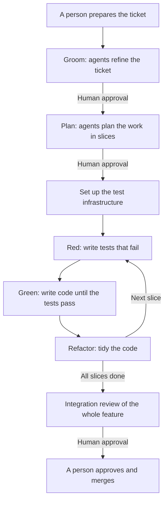

Author
: Matthew Deeprose, University of Southampton

Event
: AbilityNet TechShare Pro 2026, London and online, 18 and 19 November 2026

TechShare Pro is AbilityNet's annual digital accessibility conference, and this year it ran for two days in London and online. AI came up in almost every session. This post covers my five favourite sessions, then rounds up what the event said about AI, sets my own approach at the University of Southampton against it, and ends with the other threads I noticed and the questions I'm still asking.

## In brief

- My five favourite sessions covered documentation for AI readers, software factories, how practitioners use AI, Hawk-Eye's inclusive Wimbledon feed, and Barclays' AI sandwich.
- Speakers agreed that AI should handle the mechanics, with deterministic checks in between and people making the decisions.
- The question left open was whether interfaces still need fixing if AI agents operate websites for disabled people.
- My own approach tells students first, has students and AI tools do the fixing, builds the checks into the code, and puts every decision in writing.
- My main takeaway is to put accessibility at both ends of AI-assisted work: testable criteria at the start, and people, including disabled people, checking the result at the end.

<figure class="demoImage">

<figcaption>The view towards Wembley Stadium on the morning of day two. Photo by Matthew Deeprose.</figcaption>
</figure>

[toc]

## My five favourite sessions

For each one I've picked a slide that sums it up, and said what I'm taking away.

### Write down what you decided not to do

Session
: A11yBites: AI is making the case for accessible documentation

Speaker
: Geri Reid, Lead Accessibility Specialist, Just Eat Takeaway

Geri built a small tool that asked an AI model for accessibility guidance on any component you named. Given random words, it invented components.

<figure class="demoImage">

<figcaption>An AI tool invents components that nobody defined for it. Slide from Geri Reid, Just Eat Takeaway, A11yBites: AI is making the case for accessible documentation.</figcaption>
</figure>

Geri's argument is that AI-ready documentation needs what accessibility specialists have asked for over many years: consistent names, predictable structure and no ambiguity. Geri uses the RFC 2119 words (must, must not, should, should not) so that every reader can tell a rule from a recommendation.

Product teams make decisions all the time, and the reasons, such as "why we said no to three other ideas", stay "undocumented in people's heads". A colleague might ask. An agent acts on what it reads. Geri's line for this was "My readers have arrived, and they are robots."

Geri showed a notification component written as a schema that records the decisions a designer would usually leave unsaid.

<figure class="demoImage">

<figcaption>A notification component recorded as a set of decisions. Slide from Geri Reid, Just Eat Takeaway, A11yBites: AI is making the case for accessible documentation.</figcaption>
</figure>

<details>
<summary>Text of the schema on the slide</summary>

```yaml
schema: design system spec
id: notification
version: 1

props:
  variant:
    type: enum
    values: [info, success, warning, error]
    default: info
  message:
    type: string
    required: true
  dismissible:
    type: boolean
    default: false
  dismissLabel:
    type: string
    required: when dismissible

variants:
  success:
    icon: icon.success
    role: status
    tokens:
      background: color.feedback.success.background
      border: color.feedback.success.border
      icon: color.feedback.success.icon
      text: color.feedback.success.text
    # info, warning and error follow the same pattern

accessibility:
  statusIcon: decorative, aria-hidden true
  variantMeaning: MUST NOT rely on colour or icon alone
  announcement: live region MUST exist before the message
  dismissButton:
    accessibleName: MUST come from dismissLabel
    focusIndicator: visible, 3:1 contrast
    minTouchTarget: 44x44px
```

</details>

On funding, Geri said "the machines just gave us a budget", so borrow your organisation's AI money for clearer documentation.

My takeaway: document what you decided not to do, and why. That unsaid reasoning lives in people's heads, and AI cannot read it.

### What a software factory is, and where accessibility fits

Session
: Inside the AI software factory: where accessibility is won or lost

Speakers
: Dylan Barrell, Deque
: Will Sutton, Head of Innovation, AbilityNet

I build with Claude Code, but "software factory" was a new term to me, and a show of hands suggested only about 10 per cent of the room knew it.

A software factory is a pipeline of AI agents that takes a piece of work from an idea to code you can deploy. Agents refine the ticket, plan the work, write tests and code, and review each other's output, in loops. People set the intent and approve the work at fixed points. Dylan's own pipeline has three human approval stages and 13 or 14 different reviews.

Dylan's factory is on GitHub as [agent-terminal](https://github.com/dylanb/agent-terminal), a free, open-source app that takes a ticket through coding agents such as Claude Code. It's an early version and doesn't run on Windows yet. Its README sets out each stage, so I've drawn the pipeline from there. At most stages, reviewer agents check the work and the coding agent fixes what they find, and "the cycle repeats until a round changes nothing". Accessibility reviewers check the code at two stages, and "Merging is always left to a person." Select Show Description under the diagram for a text version.



For accessibility, Dylan described three levels. With no accessibility guidance, the factory builds inaccessible products. With requirements, an accessibility reviewer and axe-core, it builds accessible components. Dylan's own agent terminal reached that second level and still trapped keyboard users between features. Its live region was never cleared, and after 10 hours of running it held 250 megabytes of text. Will summed it up: "The moment you try and compile that into complex user flows and journeys, it falls apart."

Their answer puts accessibility at both ends of the line. At the start, each ticket carries specific, testable accessibility acceptance criteria, because "WCAG 2.2 AA" is too broad to test, and the tests are written before the code. At the end, people test whole journeys, ideally with disabled users. Will warned: "if you embed accessibility into this, and it becomes the thing that slows it down, it's gonna get dropped really quick."

My takeaway: the accessibility work moves to the two ends of the pipeline, into the ticket and into journey testing, and I need to put it there in my own AI-assisted work.

### What practitioners use AI for

Session
: Connecting Practitioners Across the Accessibility AI Landscape

Speakers
: Aidan Tierney, Lead Product Manager Accessibility, eBay
: Mark Lapole, Director of Accessibility, eBay

Aidan ran a workshop around the areas on this slide, with a live poll asking the room and the online audience whether each one applied to them.

<figure class="demoImage">

<figcaption>The nine areas of AI accessibility work that the session polled. Slide from Aidan Tierney and Mark Lapole, eBay, Connecting Practitioners Across the Accessibility AI Landscape.</figcaption>
</figure>

Here are four of the results. About 30 people replied to each poll, so this is a snapshot of one room.

| Poll question | Answered yes |
| --- | --- |
| Do you personally use AI in some aspect of your accessibility work? | 96% of 26 |
| Do you use AI to create or deliver accessibility guidance? | about three quarters of 32 |
| Do you use AI to influence accessible design workflows? | 47% |
| Do you use AI to surface real-world customer accessibility signals? | 19% |

Guidance led, through tools such as an internal answer bot in Slack. Customer insight came last. A game of "two truths and a lie" followed, and 96 per cent of 28 voters spotted "using AI to replace disabled user testing" as the lie.

My takeaway: nearly everyone in the room uses AI, mostly to explain accessibility to colleagues. Fewer than one in five use it yet to learn from what disabled customers tell us.

### A Wimbledon feed designed with its audience

Session
: Sony Hawk-Eye: Inclusive Feedback For Wimbledon

Speakers
: Luke Digweed, Hawk-Eye Innovations
: Simon McCormick-Cox, Hawk-Eye Innovations
: Johnny Marshall, RNIB

Hawk-Eye built HawkAR Inclusive Feed, an alternative Wimbledon broadcast on BBC iPlayer for blind and partially sighted fans. It overlays high-contrast ball trails and shot speeds on the picture, and plays spatial audio cues for shots and bounces.

<figure class="demoImage" id="figure-inclusive-feed-system">

<figcaption>How tracking data becomes visual overlays and spatial audio. Slide from Luke Digweed and Simon McCormick-Cox, Hawk-Eye Innovations, Sony Hawk-Eye: Inclusive Feedback For Wimbledon. <a href="#inclusive-feed-system-diagram">Long description of the Inclusive Feed diagram</a>.</figcaption>
</figure>

The team opened with an honest line: "We do not profess to be experts in all things accessibility." With RNIB and the Lawn Tennis Association, they formed a focus group of visually impaired tennis players, and the group became co-designers. They fixed the ball speeds in one place on screen and chose the colours of the ball trails. Wimbledon and the BBC accepted every change they asked for. As Johnny put it, "So co-design is critical to any service that goes out."

<figure class="demoImage" id="figure-inclusive-feed-reach">

<figcaption>Reach of the Inclusive Feed at Wimbledon 2026. Slide from Luke Digweed and Simon McCormick-Cox, Hawk-Eye Innovations, Sony Hawk-Eye: Inclusive Feedback For Wimbledon. <a href="#inclusive-feed-reach-figures">Long description of the reach slide</a>.</figcaption>
</figure>

The feed reached more than 15,000 iPlayer accounts and streamed more than 3,000 hours. In the follow-up survey, 70 per cent of respondents had no registered visual impairment.

The team also said what went wrong: no explainer for the sounds, no way to turn the sounds off, and a late move into iPlayer's audio-described section that added clicks. As Johnny said, "if people don't know the services there they're not going to access it".

My takeaway: co-design shaped the product, and promotion and explanation decided who found it.

### Barclays on scale, speed and judgement

Session
: Barclays: Accessibility at Enterprise Scale in the Age of AI – What Actually Works?

Speakers
: Abi James, Barclays
: Paul Smyth, Head of Digital Accessibility, Barclays

The workshop worked through four tensions: distributed ownership against clear accountability, consistency against proportionality, scaling capability against preserving quality, and AI-enabled scale against new accessibility risk.

The slide for the fourth tension names the trade-off: "Extend capability with AI, not weaken judgement". Abi described technology teams who want to move fast and "vibe code" while accessibility teams have to check the output. Paul's answer was the "AI sandwich".

<figure class="demoImage">

<figcaption>The accessibility AI sandwich. Slide from Abi James and Paul Smyth, Barclays, Barclays: Accessibility at Enterprise Scale in the Age of AI – What Actually Works?</figcaption>
</figure>

AI helps at each end: sorting out which requirements apply to a new website or PDF, and pulling together test results from different tools. The middle stays rules-based and repeatable, because "We can't let LLMs go off the rails." And people decide: "it's important that the AI tools aren't making decisions".

For scale, business logic can pick which PDFs matter, such as those sent to many customers, and send only those to a person. Paul also urged accessibility teams into AI governance, so that new AI tools are "born accessibly".

My takeaway: the sandwich puts names to something I already do. AI drafts and sorts, deterministic checks test, and a person decides.

## What the event said about AI

Four of my five favourite sessions were about AI, and so were many of the others I caught up on. Here is where the speakers stood, where they agreed, and the question they left open.

### Where practitioners are now

The eBay polls, above, give the starting point: almost everyone in that room already used AI, but few used it yet to hear from disabled customers.

### Hand AI the mechanics

This is where speakers agreed most. Barclays' AI sandwich and the software factory, both above, keep deterministic checks between the AI steps and keep a person making the decisions.

Preety Kumar, CEO of Deque, put the reason most sharply in the panel on risks and rewards. "AI generates plausible output", Preety said, and plausible is not authoritative. An agent that learns from a web where 96 per cent of sites are inaccessible "may actually very faithfully encode the defect as the expected result". Preety's advice was to "hand over the mechanics, not the meaning", and not to take an agent's word that something meets WCAG.

Ashley Firth, Deputy CTO of Octopus Energy, said AI is "great with toil", such as working through WCAG, and compared some AI promises to overlays, sold as a fix "without you necessarily knowing how they're being done". On Preety's panel, Neil Barnett, Chief Accessibility Officer at Microsoft, named the skill we now need: "AI judgment".

### Do interfaces still need fixing?

The event left one question unsettled: if AI agents operate sites for disabled people, do the interfaces underneath still need fixing?

Ed Summers, Head of Accessibility at GitHub, made the most optimistic case, setting out five drivers of what he called a renaissance of achievement for disabled people.

<figure class="demoImage">

<figcaption>Five drivers of a renaissance of achievement for disabled people. Slide from Ed Summers, GitHub, The Renaissance of Achievement for People with Disabilities.</figcaption>
</figure>

The third driver, AI-native interfaces, would let disabled people "bypass all that existing accessibility debt". Ed named four risks, including bias against disabled people, then set them aside on purpose. Jamie Knight of Plus Lion described the same shift in his own day: "my agentic agent goes on websites for me".

Research from AbilityNet and The Stepstone Group points the other way. Ell Martin of AbilityNet and Mimouna Mahdaoui of The Stepstone Group presented a survey of 251 disabled job seekers.

<figure class="demoImage">

<figcaption>Disabled job seekers on recruiters' use of AI. Slide from Ell Martin, AbilityNet, and Mimouna Mahdaoui, The Stepstone Group, AI in Recruitment: Outcomes for Disabled Candidates.</figcaption>
</figure>

Almost half (45 per cent) said recruiters' use of AI had made it harder to find and apply for jobs, even though 73 per cent use AI tools themselves. One respondent, quoted on a slide, said "You end up using AI to beat AI." Mimouna said that the EU AI Act, more than the European Accessibility Act, is what will improve accessibility in recruitment.

Two sessions showed AI built with disabled people, not around them. HSBC published AI-generated Hong Kong Sign Language videos, made with the start-up GlassBox AI, on its Hong Kong cybersecurity and fraud prevention pages. The videos are pre-recorded and checked for accuracy before they go live. HSBC could have launched about 18 months earlier, but the team first went to ask Deaf people in person, "do you want this". It has no UK roadmap, and says the Deaf community will lead any decision.

Helen Charles of Meta, talking about AI glasses, argued against carve-outs that would make disabled people prove they qualify, and asked policymakers to talk to disabled users before they set policy.

#### My view

Nobody on stage settled the question, so here is my answer: yes, the page still has to be accessible. An agent is a welcome extra choice for disabled people, but it can't be the only way in, for five reasons.

1. It already costs more to be disabled. Scope's Disability Price Tag puts the extra cost at £1,095 a month for the average disabled household, just to reach the same standard of living as non-disabled households. If access depends on an AI subscription, we add to that bill.
2. Agents read the accessibility tree too. Browser agents such as Microsoft's Playwright MCP work from the same structure a screen reader uses, because it is fast and precise, and working from screenshots costs more and means guessing from pixels. Miro found the same thing by accident. An inaccessible page is harder for the agent as well, so the agent depends on accessibility; it doesn't replace it.
3. The person can't always check the agent's work. When Mathpix read a lecturer's handwritten pi as 55, my workflow had a subject expert to catch it. A blind student who relies on an agent may never know the page said something different. Using the page directly is how you check.
4. Handing an agent control carries risk. The Secure by Inclusion session showed that when disabled people can't use a login, they end up sharing passwords or relying on helpers. An agent holding your credentials, inside your bank account or student record, is the same workaround with new risks.
5. Some settings don't allow AI, and the duty stays with the organisation. Many assessments restrict AI tools, and a student still has to read the exam paper. Under the Equality Act 2010 and the accessibility regulations, the duty to be accessible sits with us, not with whatever tool a disabled person can afford.

The recruitment research adds one more reason to be careful. AI often sits on the organisation's side of the interface, where the person has no say in how it behaves. An agent that reads a website for you can't help when the organisation's AI is the one judging you.

### A new business case

Jen Jones, Chief Marketing Officer at Siteimprove, told leaders that "your accessibility backlog is the same as your AI visibility backlog". Geri made the same case for documentation, above. Miro's Phillip Strain said the HTML layer built for screen reader users let Claude Code work with a Miro board, which the team discovered by accident.

Preety predicted that accessibility, long "the orphan child", will become a requirement, because agents need the same semantic hooks. Neil added the warning in reverse: bad content coming in "at the speed of AI" is only going to multiply.

Jen also warned against writing for machines: design for people, and the AI problem is solved as well. The ethics sessions went further and warned against resting everything on this argument. Lainey Feingold and Reginé Gilbert said the legal case and the business case are both critical and both not enough. Their slide put it this way: "Compliance gets you in the room after it's bought. Ethics gets you in before."

Reginé asked whether anyone in the room had been asked to approve an AI tool this year, and if so, before or after it was bought, then gave three questions to ask before any purchase.

<figure class="demoImage">

<figcaption>Three questions before buying an AI tool. Slide from Lainey Feingold and Reginé Gilbert, Why Ethics Is a Boardroom Issue for AI and Accessibility.</figcaption>
</figure>

### What AI does to our jobs

In the panel on the changing profession, Jamie said auditors who only audit should "go up the value chain" into advice. Gareth Ford-Williams said you cannot shift left with an audit, and would like to see "the death of auditing". Others disagreed. Ashley values external audits because you cannot "mark your own homework", and Fay Gasiorowski said Bupa plans audits of every digital product.

The jobs question also came from the other side. A Tech4Good award winner, the MARS project, built an app that helps speech and language therapists analyse the stories of people with aphasia. Each story took about eight hours to analyse by hand, and "the human and the app together saved seven hours and 30 minutes per story". The therapist still does the work, with the app doing most of the slow analysis.

## How I'm approaching it

My own talk sat in the same stream: [A11yBites: Your module has 47 accessibility issues. Now what?](ts26.html) Here is how my work sets against the positions above, including work in the codebase behind my tools that didn't fit into 20 minutes. In short, it follows the Barclays AI sandwich, above. How the talk itself went is in [My own talk](#my-own-talk), near the end.

### Tell students first

Telling students comes before any AI. Almost two thirds of our taught modules have 47 or more accessibility issues, and one in five of our students now disclose a disability. A module accessibility statement shows each module's students the same agreed text, the module lead's answers, and live data from Ally, the accessibility checker in our virtual learning environment.

<figure class="demoImage" id="figure-module-statements">

<figcaption>Module leads answer six questions, and students see only agreed wording. Slide from my talk, A11yBites: Your module has 47 accessibility issues. Now what? <a href="#how-module-accessibility-statements-work">Long description of the module statement slide</a>.</figcaption>
</figure>

Our Students' Union, student disability team and academics agreed the wording students read. The data side met pushback. Academics warned that listing barriers before staff can fix them could create tension, particularly in STEM. So we struck a bargain, set out on one of my slides: "Showing the problem without enabling the fix can make things worse." We're piloting the statements in four modules first, and we'll decide after that pilot when students see the data.

### Students and AI tools do the fixing

The fixing starts with people. Our Accessibility Allies are paid student interns, trained in accessibility. In 12 weeks in 2025, three of them raised the average accessibility score of 14 modules from 59 to 91 per cent, working first on modules with students who had disclosed a disability. Modules without allies rose 11 points in a whole year.

AI comes in through the tools. Buying is our default, but the market is thin, so I build browser tools with Claude Code that run with your own API key and need no sign-in. Each tool drafts, and a person finishes:

- The Image Describer asks for the subject, topic and learning outcome before it writes, because the right alt text depends on why a module uses the image.
- The MathPix tool turns scanned handwritten maths into text a screen reader can read, an AI step looks for the mistakes the OCR made, and a subject expert does the final edit.
- An alt text editor records who wrote each description: an AI model, an AI model with a person's review or edit, or a person alone.

Mathpix read a lecturer's handwritten pi as 55, and as I said in the talk, "an inaccurate document is even worse than an inaccessible document in terms of learning". My aim is to cut the human share of the work from 100 per cent to 10 per cent, not to zero.

<figure class="demoImage" id="figure-misplaced-u">

<figcaption>Models placed the U label correctly four times in 12, and 11 times in 12 once a person had confirmed the labels. Slide from my talk, A11yBites: Your module has 47 accessibility issues. Now what? <a href="#the-case-of-the-misplaced-u">Long description of the misplaced U slide</a>.</figcaption>
</figure>

The piston diagram shows the pattern. Models kept putting the U label at mid-height on the right. I added text detection and let a person correct or add any label it missed, and the label came out in the right place 11 times in 12.

### Checks in the code

I build the tools mainly with LLMs, so the middle of my sandwich sits in the code. I wrote the checks into how Claude Code works.

<figure class="demoImage" id="figure-claude-code-checks">

<figcaption>Where the checks sit as Claude Code works. Slide from my talk, A11yBites: Your module has 47 accessibility issues. Now what? <a href="#accessibility-checks-with-claude-code">Long description of the Claude Code checks slide</a>.</figcaption>
</figure>

After every edit, IBM Equal Access and axe check the page, and Claude Code can't carry on until it fixes a violation or tells me why it thinks the result is a false positive. Further checks cover label-in-name and forms, where I found the models trip up. For live regions, disabled buttons and focus after a dialog closes, Claude Code writes a test, and I run it with a real screen reader. The starter kit I shared says it plainly: "A clean check is not a guarantee."

You can try the same set-up yourself. The [Claude Code accessibility starter kit (ZIP, 294KB)](https://blackboard.soton.ac.uk/bbcswebdav/xid-41566059_1) is free and needs no API key, and its START-HERE file walks Claude Code through installation and a tour.

I've also learnt to check the checkers. When I counted the defects recorded across 50 of my Claude Code sessions, 18 of the 20 sessions that had any traced them to the throwaway test scripts the AI wrote to measure its own work. Only one defect was in the tools people use. So a new test now has to show it can fail before I trust its pass.

### Decisions in writing

Here I follow Geri's advice, mostly without having heard it. Every decision I make about the tools goes into the project's guidance files with the date and my reason, and that is where Claude Code reads it before it works.

Some of those decisions took features out. I tested a depth-estimation model with the Image Describer, and passing its results to the language model did more harm than good, so it went. An image classifier with seven categories went the same way. The tool used to start reading the text in every picture as soon as it loaded. On a painting with no text, that produced garbage and could lock the browser for a minute. Now it asks "Detect text in this picture?" and waits for the person to choose.

### Where I differ

Here is where my work goes beyond the sandwich, or sits beside it.

- Where a rule can do the job, I use the rule and no AI. My Mermaid describer reads the text that draws a diagram, counts the concepts and levels, and fills a template, so the same diagram always gets the same description. As my slide says, "It describes the structure, not the meaning." It covers 28 of Mermaid's diagram types and works today in the Markdown Editor in [my accessibility tools](https://matthewdeeprose.github.io/tools.html).
- A separate [chart description library](https://github.com/matthewdeeprose/chart-describe), which describes Chart.js bar, line and pie charts and the data behind Mermaid's pie, radar and xychart diagrams, is on GitHub now. The Mermaid describer will follow as a library once its reviews are clean.
- People judge the output without knowing where it came from. A blind academic reads two unlabelled descriptions from different models or prompts and tells me which works better, and why. I've built the same kind of blinded comparison pages for other academics.
- When I use an AI model to compare descriptions at scale, its limits are written into the code beside it, including "an LLM judge is not a lecturer".

### What I haven't solved

Some of this is unfinished, and the talk said so. We haven't yet shown live module data to students, and we'll decide when after the four-module pilot. I haven't measured the 10 per cent figure for human time, and I'm unlikely to: a fair comparison would mean asking someone to do a whole document by hand, which isn't a kind thing to ask. An automated check still can't tell whether alt text suits its context. Only a person who knows why the image is there can judge that.

## The wider picture

Away from AI, three more threads ran through the sessions I caught up on.

### Standards on hold

Kevin White of the W3C expects WCAG 3 to reach final recommendation around mid-2029. Until then, keep meeting WCAG 2.2: Wilco Fiers said nothing you do for WCAG 2 is wasted effort. The new idea in WCAG 3 is assertions, which are claims about your accessibility work, such as training or plain language review, backed by evidence you keep.

### Lived experience in almost every session

This was the most consistent thread. Hawk-Eye's co-designers shaped its feed, HSBC asked Deaf people before it launched, and Ashley said AI cannot "replace these lived experiences". Even the software factory talk argued for moving budget towards usability testing with disabled people. In the closing panel, Jared Clayton of HSBC said that we sometimes skip over the barriers that have always been there "and go straight to the technology".

### Whose voices we heard

Large organisations dominated, mostly finance and big tech. When I counted the speakers' organisations, I found 13 technology companies and 20 other businesses, and HSBC alone had seven speakers. Only six came from universities and education, and eight from the public sector, regulators and standards bodies. I heard little from small organisations. Cognitive access, which speakers agreed is where WCAG 2 is weakest, had one session of its own, and I couldn't watch it back because it wasn't recorded.

## Questions I'm still asking

The event left me with three questions about AI that I can't yet answer.

1. Who tests agents with disabled people before organisations recommend them? Vendors say an agent can open a site on someone's behalf, but I heard no evidence that disabled people had tried it on the tasks that matter to them, such as booking an appointment or submitting coursework.
2. How do we judge AI-written descriptions at the scale of a whole university? The people best placed to judge them, disabled students and subject experts, have the least spare time.
3. Who in a university gets asked before an AI tool is bought? Reginé's third question, whether disabled people were asked, is one I want us to be able to answer yes to.

## What I am taking away

Writing down my decisions now matters more to me than before, including the things I chose not to build and the features I took out, so that the agents I work with and the people after me can follow them. In my AI-assisted work, testable accessibility criteria will come at the start, and people, including disabled people, will check the result at the end. Preety's line will stay with me: AI can have the mechanics, and people keep the meaning. Before our next AI purchase, I'll ask Reginé's three questions. And at next year's event, I will look for education and public sector voices, because our questions were the least represented this time.

## My own talk

More people came than I expected, and the feedback was good, both in the room and online. One person in the online chat called it "amazing work", and [Ronny Hendriks wrote on LinkedIn](https://www.linkedin.com/posts/ronnyhendriks_techsharepro-accessibility-share-7528786999474831362-wUdq/) that it was "Lovely work and encouraging progress".

The online stream had technical problems and only started about 10 minutes into the talk, so the recording misses the opening. The recording is also a wide, dark shot of the room in which you can't read my slides, though the room itself was well lit. Compare Ronny's photo, taken in the room, with a frame from the recording a few minutes later.

<figure class="demoImage">

<figcaption>In the room, at 11:37. Photo by Ronny Hendriks, shared on LinkedIn.</figcaption>
</figure>

<figure class="demoImage">

<figcaption>On the recording, at 11:40. Frame from the AbilityNet TechShare Pro 2026 recording of my session.</figcaption>
</figure>

So I'm recording my own version of the talk this week and will put it on YouTube. Until then, the slides and links are on [my talk page](ts26.html).

## Thank you

TechShare Pro was a welcoming event. Everyone I met was easy to talk to, and there was coffee whenever I wanted it. A big thank you to AbilityNet, especially Amy Low, Mark Walker and their brilliant team, and to the sponsors who make the event possible.

## Appendix: long descriptions

These are fuller descriptions of the slides that hold more than their alt text can carry. Each one links back to its slide.

### Inclusive Feed system diagram

The slide is headed "Hawk-Eye Innovations: HawkAR" and titled "Inclusive Feed - How". It is a flow diagram read from left to right.

1. On the left, a plan view of a tennis court is ringed by 12 cameras.
2. A line runs from the court to a box labelled "HEI Ball and Player Tracking Data".
3. A separate box, labelled "Video Feeds", sits above the tracking data box.
4. Both boxes point into a dashed area labelled Unreal Engine. Inside it, the video feeds and the tracking data both go to the HawkAR Engine, and the tracking data also goes to the Action Audio Plugin.
5. The Action Audio Plugin sends "Spatial Audio" up to the HawkAR Engine.
6. The HawkAR Engine sends its result to a box on the right labelled "SDI Output".

The background is a faded photo of a match on Wimbledon's Centre Court.

[Back to the Inclusive Feed diagram](#figure-inclusive-feed-system)

### Inclusive Feed reach figures

The slide is headed "HawkAR: Inclusive Feed" and titled "HawkAR Inclusive Feed x Wimbledon", with the Championships logo. Its subtitle is "Setting a New Benchmark for Accessibility in Live Sports Broadcasting".

Four figures run across the top right:

| Figure | Label on the slide |
| --- | --- |
| 15k+ | Total accounts reach on BBC iPlayer |
| 2.8k | Peak daily account reach on Day 10 |
| 3k+ | Total streamed hours of Inclusive Feed content |
| 441 | Peak streamed hours of Inclusive Feed content on Day 2 |

Three ticked points on the left say the feed:

- transforms live tennis coverage into a fully immersive, independent experience for blind and low-vision fans
- was deployed across all singles matches on Centre Court during the Championships, Wimbledon 2026
- was available nationwide as an "alternative screen" across the UK through BBC iPlayer, under the "Audio Described" section

Two boxes below explain the two parts:

- Action Audio, 3D Spatial Soundscape: converts real-time ball and player tracking data into 3D audio cues, so listeners can hear ball speed and trajectory.
- Hawk-Eye, AR Overlays: delivers high-contrast visual overlays showing precise bounce points and shot paths for low-vision viewers.

On the right, BBC and RNIB logos sit above a still of a match between Auger-Aliassime and Djokovic, shown on a television. A thick, bright yellow trail traces the ball's path across the court.

[Back to the reach slide](#figure-inclusive-feed-reach)

### How module accessibility statements work

The slide has two rows joined by lines.

The top row, "Module lead / instructor", has two boxes and the note "6 questions in total":

- "5 yes/no questions", based on Blackboard Universal Standards
- "1 free-text question", for a written response

A line labelled "For each yes/no question" runs from the first box down to the bottom row, "Student view", and splits into two boxes:

- YES: "Agreed message appears", with the same wording for everyone.
- NO: "No message appears", and students cannot see the answer.

A note at the foot reads "Message wording agreed with the Students' Union, academics and other colleagues", above the link go.soton.ac.uk/ts26.

[Back to the module statement slide](#figure-module-statements)

### The case of the misplaced U

On the left, a line drawing shows a gas in a closed cylinder under a grey piston, with red dots for the gas particles. A blue arrow points up from the top of the piston. Three labels sit around it:

- Q, on the left, with a red arrow pointing into the cylinder
- P.V, on the upper right, with a black arrow pointing to the piston
- U, at the bottom right, with a long thin black arrow pointing left into the gas

Below the drawing, the slide reads "4 of 12 right, then 11 of 12".

On the right, two boxes quote AI descriptions of where the U label sits:

- "Told nothing extra": "U, positioned on the right-hand side at approximately mid-height."
- "Told where each label sits": "U, bottom-right of the image, with a long thin black pointer arrow directed left into the gas region."

The first description puts U too high. The second matches the drawing.

[Back to the misplaced U slide](#figure-misplaced-u)

### Accessibility checks with Claude Code

The slide lists checks in four boxes, from top to bottom.

1. Before a command runs: no searching every folder at once; no reading a huge file in one go; no writing files through the terminal.
2. After every edit (hooks): two WCAG engines check the page; a violation stops the assistant until fixed.
3. On request (skills): a virtual screen reader (Guidepup); label-in-name and form behaviour checks.
4. Assisted screen reader tests: guided tests launch automatically for changes to live regions and disabled buttons, focus after a dialog closes, and screen-reader-only text.

[Back to the Claude Code checks slide](#figure-claude-code-checks)
